# RomClub 🚀

[](https://www.android.com/)
[](https://developer.android.com/about/versions/14)
[](https://developer.android.com)
[](https://firebase.google.com/)
[](LICENSE)

---

## 📖 About the Project

**RomClub** is an all-in-one Android companion application designed specifically for custom ROM enthusiasts, power users, and aftermarket developers. It provides a centralized hub to discover, verify, and download device-specific custom ROMs, custom kernels, and root modules (Magisk/KernelSU). The app bridges the technical gap for everyday users by offering comprehensive, step-by-step flashing tutorials with built-in safety advisories, hash integrity checks (MD5/SHA-256), and security patch updates. Built natively for Android and backed by Firebase Realtime Database, RomClub delivers a fast, clean, and reliable tool for Android customization.

---

## 📱 Screenshots

### 🌟 UI Design Screens
<p align="center">
  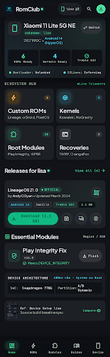
  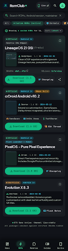
  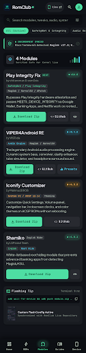
  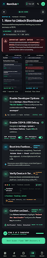
</p>

### 📲 App Walkthrough

| Welcome & Splash | Device Hub & Specs | ROM Catalog | ROM Details & Changelog |
| :---: | :---: | :---: | :---: |
| 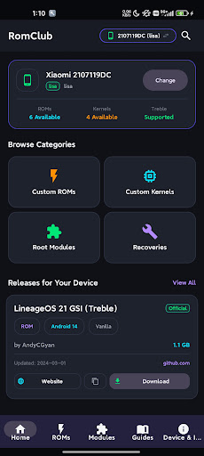 | 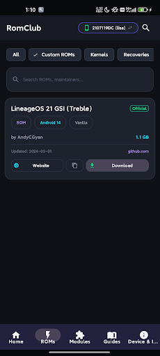 | 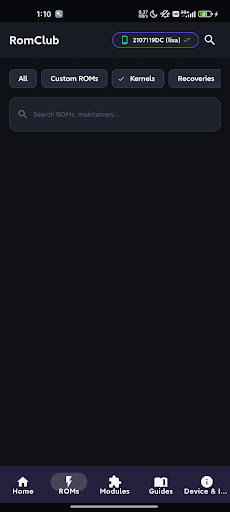 | 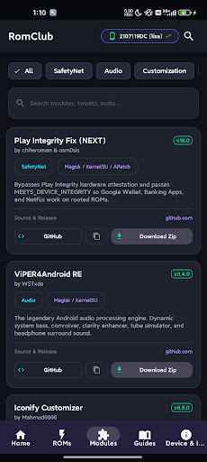 |

| Root Modules | Flashing Guides | Step-by-Step Instructions | Developer & Contact Info |
| :---: | :---: | :---: | :---: |
| 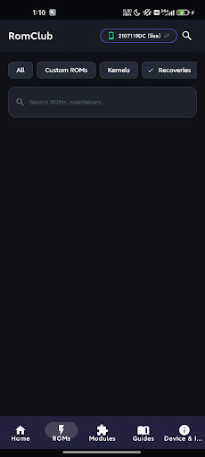 | 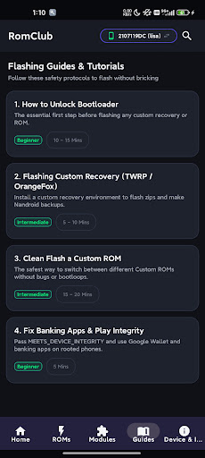 | 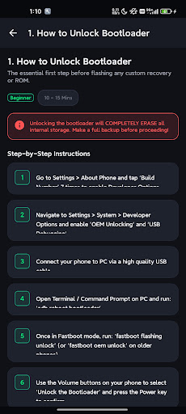 | 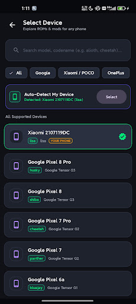 |

---

## ✨ Features

- 📱 **Device-Specific Catalogs**: Automatic detection and manual selection for popular device codenames.
- ⚡ **Custom ROM Library**: Explore popular Android distributions (LineageOS, Pixel Experience, Evolution X, crDroid, ArrowOS, and more) with version history, release notes, and direct download links.
- 🧩 **Root Modules & Tweaks**: Curated collection of essential Magisk, Zygisk, and KernelSU modules for performance, audio mods, and customization.
- 📚 **Interactive Flashing Guides**: Clear, rookie-friendly step-by-step walkthroughs for unlocking bootloaders, flashing custom recoveries (TWRP, OrangeFox), and installing ROMs.
- 🛡️ **Checksum Verification**: Built-in verification display for SHA-256 / MD5 hashes to prevent corrupt downloads and bricked devices.
- ☁️ **Live Cloud Updates**: Powered by Firebase Realtime Database for instantaneous content updates without needing APK reinstalls.
- 🌓 **OLED-Optimized Dark UI**: Modern dark theme crafted with sleek glassmorphism and Material Design standards.

---

## 🛠️ Tech Stack & Architecture

- **Operating System**: Android (API 24+ / Android 7.0 Nougat to Android 14)
- **Programming Language**: Java
- **UI Framework**: Android ViewBinding, Material Components (`com.google.android.material`), ConstraintLayout, RecyclerView, CardView
- **Cloud Backend**: Google Firebase Realtime Database (`com.google.firebase:firebase-database`)
- **Build System**: Gradle with Kotlin DSL (`build.gradle.kts`), Java 17

---

## 🚀 Getting Started

### Prerequisites
- [Android Studio Iguana](https://developer.android.com/studio) or newer
- JDK 17
- Android SDK Platform 34

### Installation & Setup

1. **Clone the repository:**
   ```bash
   git clone https://github.com/your-username/RomClub.git
   cd RomClub
   ```

2. **Set up Firebase:**
   - Add your `google-services.json` file inside the `app/` directory.

3. **Build the project:**
   ```bash
   ./gradlew assembleDebug
   ```

4. **Run on Device or Emulator:**
   - Connect an Android device with USB Debugging enabled, or launch an AVD emulator from Android Studio.
   - Run the app via Android Studio or using:
     ```bash
     ./gradlew installDebug
     ```

---

## 🤝 Contributing

Contributions are welcome! If you would like to add device support, new ROM links, or flashing guides:
1. Fork the Project
2. Create your Feature Branch (`git checkout -b feature/AmazingFeature`)
3. Commit your Changes (`git commit -m 'Add some AmazingFeature'`)
4. Push to the Branch (`git push origin feature/AmazingFeature`)
5. Open a Pull Request

---

## 📄 License

Distributed under the MIT License. See `LICENSE` for more information.
